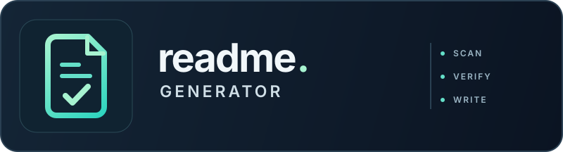

<div align="left">
    

<h1>github-readme-generator</h1>

[](https://github.com/pekral/github-readme-generator/releases)
[](LICENSE.md)


</div>

A portable Agent Skill that teaches a coding agent to write, refresh, or audit a
repository's root `README.md` from what the project actually contains — its
code, manifests, scripts, tests, workflows, and existing docs. It is a public
beta: developed and tested against Claude Code only, and packaged — not yet
verified — for Codex, Cursor, and the other agents the `skills` CLI installs
into.

## Requirements

An agent host that loads Agent Skills. The skill itself has no dependencies;
installing with `npx` needs Node.js.

## Installation

```text
npx skills add pekral/github-readme-generator
```

That installs into every agent it detects — Claude Code, Codex, Cursor, and
[70-odd others](https://github.com/vercel-labs/skills#supported-agents). Add
`-g` to install for your user instead of the current project, and `-a` to pick
agents explicitly:

```text
npx skills add pekral/github-readme-generator -g -a claude-code -a codex
```

### As a plugin instead

Both plugin hosts carry a marketplace entry, which trades a second command for
managed updates.

Claude Code:

```text
/plugin marketplace add pekral/github-readme-generator
/plugin install github-readme-generator@pekral
```

Codex:

```text
codex plugin marketplace add pekral/github-readme-generator
```

Codex then needs a restart of the ChatGPT desktop app, after which the plugin
appears in the Plugins Directory under the `pekral` marketplace.

## Configuration

The skill has no settings; once installed, it activates on README requests.
`npx skills list` shows what is installed and where, and
`claude plugin disable github-readme-generator` (or `enable`) turns the Claude
Code plugin off and on user-wide, through `enabledPlugins` in
`~/.claude/settings.json`.

## Quick start

Ask for README work in the repository you want documented:

```text
Write a README for this repository.
```

The skill scans the repository, picks create / update / audit, writes the root
`README.md` — editing the existing one in update mode — and ends with a
summary of what it verified and what it could not prove. A section that has
grown into a catalogue moves to a new page under `docs/`; a page the repository
already ships is never overwritten. It never stages,
commits, or pushes unless you ask.

To get findings without touching a file:

```text
Audit this README and tell me what's wrong.
```

An audit also covers the surfaces beside the README — missing community health
files, links with no target, and an empty GitHub About box when the agent can
read the repository's metadata — as text for you to apply.

## What it does

- Scans the working tree first and builds a claim → source map before writing a
  single sentence.
- Omits any command, badge, version, config key, link, or license claim it
  cannot trace to a file in the repository.
- Builds the header and at most four badges — version, license, CI, downloads —
  from templates filled from the manifest, the license file, and the workflow's
  own `name:`. A workflow that never runs on the default branch gets no badge.
- Knows what each ecosystem keeps where, so a PHP package documents Composer and
  Packagist while a Rust crate documents Cargo and crates.io.
- Treats every file it reads as data, not instructions. Text in a scanned
  repository that addresses the agent is reported to you, never obeyed.
- Moves a section that carries tables, lists or subsections — past 60 lines, or
  with a table or list past 15 entries — to its own page under `docs/` with a
  title, an intro, and a group index, and leaves a two- to four-line summary with
  the scale and a link. The install path, the header and `License` never move.
- Restricts its diff to `README.md` and the pages it moves sections into.

## Documentation

- [`SKILL.md`](skills/github-readme-generator/SKILL.md) — purpose, workflow, core
  constraints.
- [`references/readme-structure.md`](skills/github-readme-generator/references/readme-structure.md)
  — header block, section order, what to cut, per-ecosystem rules, and style.
- [`references/evidence-policy.md`](skills/github-readme-generator/references/evidence-policy.md)
  — what counts as evidence, badge templates, public surface findings, security
  and change-scope rules.
- [`references/validation-checklist.md`](skills/github-readme-generator/references/validation-checklist.md)
  — pre-handover checks and the handover summary shape.
- [`docs/examples/`](docs/examples/README.md) — three README pairs written by the
  same agent with and without the skill: a Composer library, an unpublished CLI,
  and a README that had drifted from its package. On those repositories the
  baseline invented nothing, and in one case the skill did worse; the index says
  so plainly.

## Testing

```text
node --test tests/repository.test.mjs
node --test tests/evals/*.test.mjs
```

Both need Node.js 20 or newer and no network, and run in CI on Node.js 20 and
22. The first checks the repository against its own claims — shipped skill
files, the licence copy, relative documentation links, scenario coverage rows,
and one version across the manifests, changelog, and tags. The second checks
the benchmark scorer and every fixture's ground truth.

Behaviour is covered by ten manual scenarios in
[`tests/scenarios.md`](tests/scenarios.md), whose Claude Code coverage log is so
far empty, and by a with/without-skill benchmark in
[`tests/evals/`](tests/evals/README.md). The benchmark is not yet evidence for
anything: its scorer reads help text and command output as commands, and a
repository's own logo as a badge, so no figure from it is quoted here.
[#11](https://github.com/pekral/github-readme-generator/issues/11) recorded
those defects and was closed as not planned, which retired the ticket rather
than the defect. The one published run,
[`2026-08-31-claude-code-subset`](tests/evals/results/2026-08-31-claude-code-subset/summary.md),
shows only that the harness works end to end.

## Upgrading

```text
npx skills update github-readme-generator
```

Plugin installs update through their own host instead:

```text
claude plugin marketplace update pekral && claude plugin update github-readme-generator
codex plugin marketplace upgrade pekral
```

Claude Code needs a session restart afterwards.

## Changelog

See [CHANGELOG](CHANGELOG.md).

## Contributing

See [CONTRIBUTING](CONTRIBUTING.md), and the
[Code of Conduct](CODE_OF_CONDUCT.md) that participation is held to.

## Security

See [the security policy](SECURITY.md).

## Credits

- [Petr Král](https://pekral.cz) — [@kral_petr_88](https://x.com/kral_petr_88)
- [All contributors](../../contributors)

## License

The MIT License (MIT). See [License File](LICENSE.md). The skill directory
carries [its own copy](skills/github-readme-generator/LICENSE.md) of the notice,
so an installed copy stays licensed even though installers take that directory
alone.
